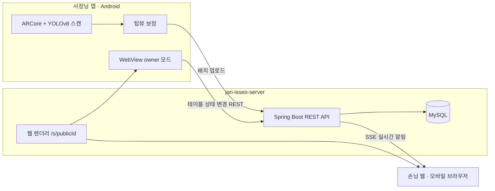

# 자리있어?! (jari-isseo-android)

> **매장을 한 번 스캔하면, 손님에게 실시간 빈자리가 보인다.**

자리있어는 손님과 가게가 같은 매장 지도를 보는 서비스입니다.
이 레포는 사장님용 Android 앱으로, 매장을 카메라로 스캔해 테이블 배치를 만들고 테이블 상태를 손님 웹에 실시간으로 반영합니다.

| 구분 | 링크 |
| --- | --- |
| 운영 서버 | https://jariisseo.mingu.cloud |
| 손님 웹 | `https://jariisseo.mingu.cloud/s/{publicId}` |
| 서버·손님 웹 저장소 | https://github.com/jari-isseo/jari-isseo-server |

---

## 기획 배경

- **손님**: 가보기 전에는 자리가 있는지 알 수 없고, 바쁜 시간에는 가게에 전화로 물어보기도 어렵습니다.
- **가게**: POS의 테이블 번호가 매장 어디인지 처음 온 직원은 모르고, 빈자리를 알리려면 전화를 받아야 합니다.

두 문제의 원인은 하나, **매장 구조와 지금 상태가 보이지 않는다**는 것입니다.
→ **스캔으로 매장 지도를 만들고, 사장님 터치 한 번으로 손님 화면에 빈자리를 보여줍니다.**

## 대상 사용자

- **사장님**: 영업 중 카운터를 지키며 손님 착석·퇴장을 입력하는 사람 (사장님 앱 · Android 폰/태블릿)
- **직원**: 처음 온 알바생도 지도로 테이블 위치를 확인 (사장님 앱 · 매장 계정 공유)
- **손님**: 방문 전 빈자리가 궁금한 사람 (손님 웹 · 앱 설치 없음)

## 사용 흐름

1. **층 추가**: 매장 층을 만들고 이름·순서를 정합니다.
2. **매장 스캔**: ARCore로 바닥·벽을 잡고, YOLOv8로 테이블을 탐지합니다.
3. **탑뷰 보정**: 위에서 본 배치 화면에서 바닥 모양·테이블·의자를 손봅니다.
4. **배치 업로드**: 보정한 배치를 서버에 저장합니다. (테이블 ID 유지)
5. **상태 전환**: 영업 중 테이블을 탭하면 빈자리 ↔ 사용 중이 바뀌고, 손님 웹에 새로고침 없이 반영됩니다.

## 주요 기능

- **층 관리**: 층 추가·이름 변경·순서 변경·삭제, 층 단위 스캔·보정
- **매장 스캔**: 벽 단계 → 가구 단계 2단계 스캔, 모서리 탭으로 방 외곽선 잡기
- **스캔 가이드**: 추적 상태 안내, 경과 시간, 완료 조건, 3분 경과 안내
- **탑뷰 보정**
  - 바닥 꼭짓점 이동·추가·삭제 (교차하는 바닥은 저장 막기)
  - 테이블 추가·삭제·이동·편집, 테이블별 좌석 수로 의자 배치
  - 배치 전체 회전, 입구 방향 표시
- **사장님 뷰**: 손님 웹과 같은 렌더러를 WebView(owner 모드)로 열어 테이블 탭으로 상태 전환, 실패 시 되돌리기, 화면 꺼짐 방지
- **영업 관리**: 전체 비우기, 영업 중 / 마감 전환, 홈 화면 '지금 빈자리' 수 표시
- **공유**: 손님용 링크 복사·QR 생성, 상태 색 없는 아이소메트릭 이미지 갤러리 저장
- **데모 모드**: ARCore 미지원 기기는 스캔을 막고, 데모 로그인으로 샘플 배치를 체험

## 시스템 아키텍처



- 사장님 앱(WebView)과 손님 웹이 같은 SVG 렌더러로 그리기 때문에, 사장님이 보는 지도와 손님이 보는 지도가 항상 같습니다.

## 기술 스택

| 구분 | 기술 |
| --- | --- |
| 언어·UI | Kotlin 2.0, Jetpack Compose (Material 3), Navigation Compose |
| AR | ARCore 1.45 |
| 객체 탐지 | LiteRT(TFLite) 1.4 + YOLOv8n |
| 네트워크 | Retrofit 2.11, OkHttp 4.12, kotlinx.serialization |
| 저장 | DataStore Preferences (토큰) |
| 공유 | ZXing (QR 생성) |
| 테스트 | JUnit 4, MockWebServer, kotlinx-coroutines-test |
| Build | Gradle (Kotlin DSL), AGP 8.10, minSdk 24 / targetSdk 35 |

## 로컬 실행 방법

### 요구 사항

- Android Studio (JDK는 Studio 내장 JBR 사용)
- **ARCore 지원 기기** ([지원 기기 목록](https://developers.google.com/ar/devices)) — 에뮬레이터·미지원 기기에서는 스캔 없이 데모 모드만 사용할 수 있습니다.

### 1. 서버 주소 설정

debug 빌드는 `local.properties`의 값을 사용합니다. release 빌드는 운영 서버(`https://jariisseo.mingu.cloud/`)를 사용합니다.

```properties
devServerUrl=http://192.168.0.10:8080/
viewerSample=false
```

| 키 | 설명 |
| --- | --- |
| `devServerUrl` | debug 서버 주소. 실기기는 PC의 LAN IP, 없으면 에뮬레이터용 `http://10.0.2.2:8080/` |
| `viewerSample` | `true`면 사장님 뷰가 실제 매장 대신 샘플 뷰어를 엽니다. (기본 `false`) |

### 2. 실행

1. 레포 clone 후 Android Studio에서 루트 폴더 열기
2. Gradle Sync 완료 대기
3. 기기 연결 후 `app` 실행 (Run ▶)

CLI로 빌드할 때는 `JAVA_HOME`을 Android Studio의 `jbr` 폴더로 지정합니다.

```bash
./gradlew assembleDebug
```

### 테스트

```bash
./gradlew testDebugUnitTest
```

스캔 좌표 변환, 바닥 다각형, 배치 내보내기, API 클라이언트, 브리지 등의 단위 테스트가 `app/src/test`에 있습니다.

### YOLO 모델

- 위치: `app/src/main/assets/yolov8n.tflite`
- 메모리 매핑(mmap)으로 읽기 때문에 `build.gradle.kts`에서 `.tflite`를 압축하지 않도록 설정되어 있습니다.

## 패키지 구조

```
com.jariisseo.android/
├── (루트)     스캔: AR 렌더링, YOLO 탐지, 바닥·벽·외곽선, 스캔 가이드, 배치 생성·내보내기
├── net/       API 클라이언트, 인증·토큰 저장, 배치 업로드, 데모 모드
├── share/     QR 생성, 갤러리 저장
└── ui/
    ├── screen/  로그인·가입, 홈, 층 추가, 보정, 뷰, 공유, 가게 정보 화면
    ├── web/     사장님 뷰·이미지 출력 WebView, OwnerBridge
    └── theme/
```

## 팀원

| 이름 | 역할 | GitHub |
| --- | --- | --- |
| 민구 | Android | [@LEEMINGU03](https://github.com/LEEMINGU03) |
| 세훈 | Backend | [@sayhoney1023](https://github.com/sayhoney1023) |
